# Documentation technique — Dashboard eSIM

Ce document explique **comment le code est organisé**, **comment les données circulent** et **pourquoi** chaque choix a été fait. Le [README](README.md) décrit l'utilisation ; ce fichier s'adresse à qui veut lire ou modifier le code.

Les schémas sont écrits en [Mermaid](https://mermaid.js.org/) : GitHub les affiche directement.

**Sommaire**

1. [Vue d'ensemble](#1-vue-densemble)
2. [Organisation du code](#2-organisation-du-code)
3. [Le moteur de nettoyage `esim/`](#3-le-moteur-de-nettoyage-esim)
4. [Les statistiques](#4-les-statistiques)
5. [La génération du site `site_builder/`](#5-la-génération-du-site-site_builder)
6. [Le dashboard dans le navigateur `site/js/`](#6-le-dashboard-dans-le-navigateur-sitejs)
7. [L'API REST `esim_api/`](#7-lapi-rest-esim_api)
8. [L'application Streamlit `streamlit_ui/`](#8-lapplication-streamlit-streamlit_ui)
9. [Sécurité](#9-sécurité)
10. [Normes du code et vérifications](#10-normes-du-code-et-vérifications)
11. [Choix techniques en résumé](#11-choix-techniques-en-résumé)

---

## 1. Vue d'ensemble

Les 18 fichiers CSV sont nettoyés **une seule fois** par le moteur Python `esim/`. Ensuite, trois interfaces utilisent ce même moteur :

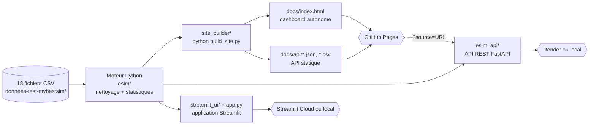

| Interface | Technologie | Hébergement | Rôle |
|---|---|---|---|
| Dashboard statique | HTML + JavaScript + Plotly.js | GitHub Pages (gratuit) | la version publique, consultable sans serveur |
| API statique | fichiers JSON/CSV générés | GitHub Pages | exporter les données d'origine en lecture seule |
| API REST | FastAPI | Render ou local | importer, filtrer et exporter par programme |
| Application Streamlit | Streamlit + Plotly | local ou Streamlit Cloud | version Python alternative du dashboard |

**Pourquoi trois interfaces ?** GitHub Pages ne sert que des fichiers et ne peut pas exécuter de Python. La page publique fait donc tous ses calculs dans le navigateur. Importer par programme ou filtrer côté serveur demande en revanche un vrai serveur : c'est le rôle de l'API. Quant à Streamlit, c'était la version de départ du projet ; on la garde parce qu'elle se lance en une commande.

---

## 2. Organisation du code

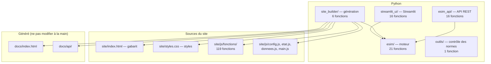

Répartition des **179 fichiers de fonctions** :

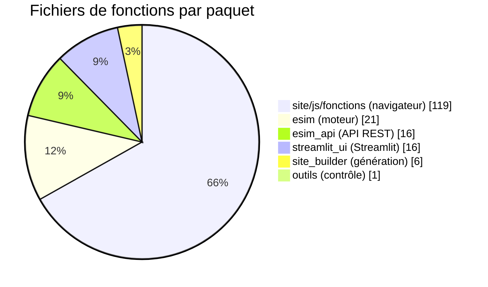

### Points d'entrée

| Commande | Fichier | Effet |
|---|---|---|
| `python build_site.py` | [build_site.py](build_site.py) | génère `docs/` |
| `uvicorn api:app` | [api.py](api.py) → [esim_api/app.py](esim_api/app.py) | lance l'API |
| `streamlit run app.py` | [app.py](app.py) | lance l'application Streamlit |
| `python rapport.py` | [rapport.py](rapport.py) | affiche les statistiques dans le terminal |
| `python outils/verifier_normes.py` | [outils/verifier_normes.py](outils/verifier_normes.py) | contrôle les normes du code |

### Deux sortes de fichiers

| Sorte | Exemples | Règles |
|---|---|---|
| **Fichier de fonction** | `esim/parse_price.py`, `site/js/fonctions/renderKpis.js` | une seule fonction nommée, qui donne son nom au fichier ; 80 lignes au maximum ; 100 caractères par ligne au maximum |
| **Fichier sans fonction** | `config.py`, `store.py`, `models.py`, `app.py`, `config.js`, `etat.js`, `main.js` | constantes, état ou assemblage ; chaque variable est documentée en français |

**Pourquoi ?** Une fonction courte, dans un fichier qui porte son nom, se trouve, se lit et se teste vite. Les constantes regroupées dans `config` se changent à un seul endroit : un seuil, une couleur ou un alias de colonne.

---

## 3. Le moteur de nettoyage `esim/`

### 3.1 Pipeline

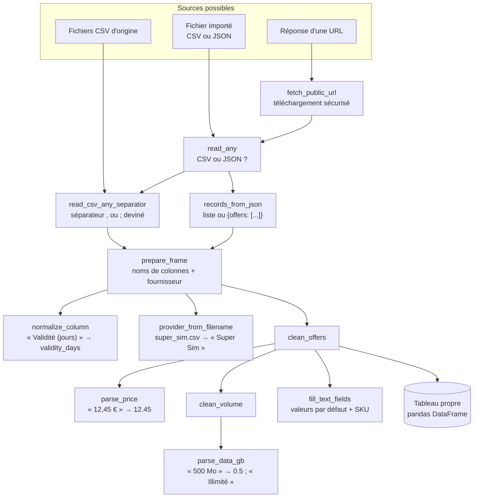

[load_offers](esim/load_offers.py) applique ce pipeline à tous les CSV d'origine. L'API, Streamlit et l'import du dashboard passent par **les mêmes fonctions** : une offre importée est nettoyée exactement comme une offre d'origine.

### 3.2 Les étapes de `clean_offers`

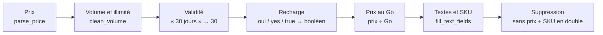

L'ordre compte : le nom d'offre fabriqué par `fill_text_fields` (« eSIM Japon 5 Go 7 jours ») a besoin du volume et de la validité déjà nettoyés. Le SKU généré dépend ensuite de ce nom et du prix.

### 3.3 Règles de lecture, et pourquoi

| Donnée brute | Résultat | Fonction | Pourquoi |
|---|---|---|---|
| `12,45 €`, `€12.45`, `1 234,50` | `12.45`, `12.45`, `1234.5` | [parse_price](esim/parse_price.py) | les fournisseurs écrivent les prix de façons différentes ; le dernier séparateur rencontré est le séparateur décimal |
| `500 Mo`, `3 Go`, `1 To` | `0.5`, `3`, `1000` Go | [parse_data_gb](esim/parse_data_gb.py) | une seule unité (le Go) pour comparer et calculer le prix au Go |
| `Illimité`, `unlimited`, `∞` | volume vide + `is_unlimited = True` | [parse_data_gb](esim/parse_data_gb.py) | un forfait illimité n'a pas de volume chiffrable : il est **exclu des moyennes**, sinon elles seraient faussées |
| `fournisseur`, `Prix`, `Validité (jours)` | `provider`, `price`, `validity_days` | [normalize_column](esim/normalize_column.py) | un fichier rédigé en français s'importe sans retouche |
| colonne fournisseur absente | nom déduit du fichier | [provider_from_filename](esim/provider_from_filename.py) | les 18 fichiers d'origine portent le nom du fournisseur |
| SKU absent | `fournisseur-empreinte` | [fill_text_fields](esim/fill_text_fields.py) | identifiant stable : réimporter le même fichier met à jour les offres au lieu de les dupliquer |
| SKU en double | la dernière version est gardée | [clean_offers](esim/clean_offers.py) | un import corrige une offre existante |

### 3.4 Modèle d'une offre

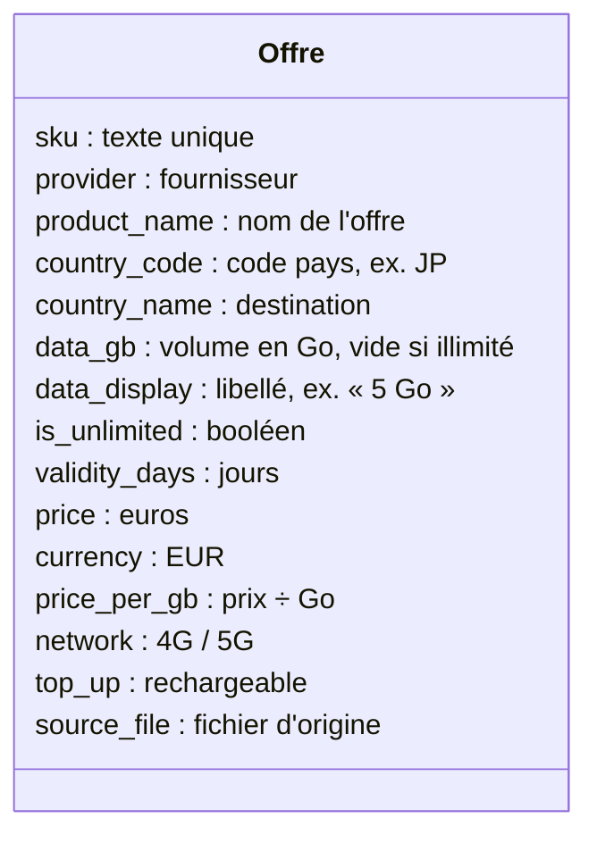

C'est aussi le format d'export ([EXPORT_COLUMNS](esim/config.py)) de l'API, de l'API statique, du dashboard et de Streamlit. Un fichier exporté par n'importe laquelle de ces interfaces peut donc se réimporter dans n'importe quelle autre.

---

## 4. Les statistiques

[compute_stats](esim/compute_stats.py) calcule les 6 statistiques demandées et les indicateurs bonus. Sa jumelle JavaScript, [computeStats](site/js/fonctions/computeStats.js), applique les mêmes formules.

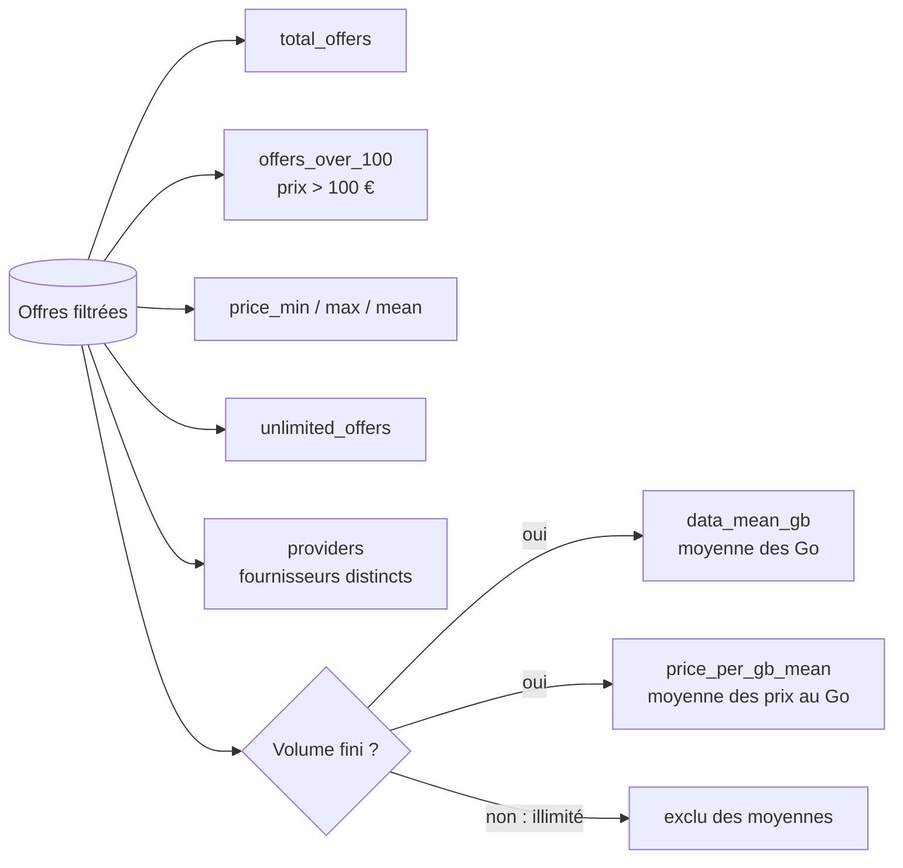

**Prix moyen au Go : pourquoi la moyenne des rapports ?** On calcule d'abord le prix au Go de chaque offre, puis on fait la moyenne de ces valeurs. On obtient ainsi le prix au Go d'une offre typique. L'autre méthode, le total des prix divisé par le total des Go, serait dominée par les gros forfaits de 50 Go.

[provider_breakdown](esim/provider_breakdown.py) donne les mêmes indicateurs par fournisseur : nombre d'offres, part, prix moyen, minimum et maximum, offres illimitées, prix moyen au Go.

---

## 5. La génération du site `site_builder/`

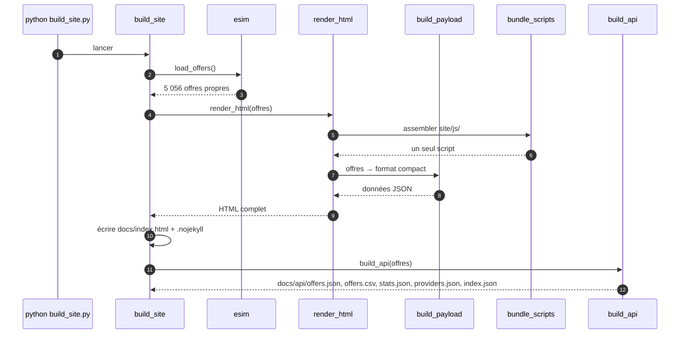

### 5.1 Assemblage en une seule page

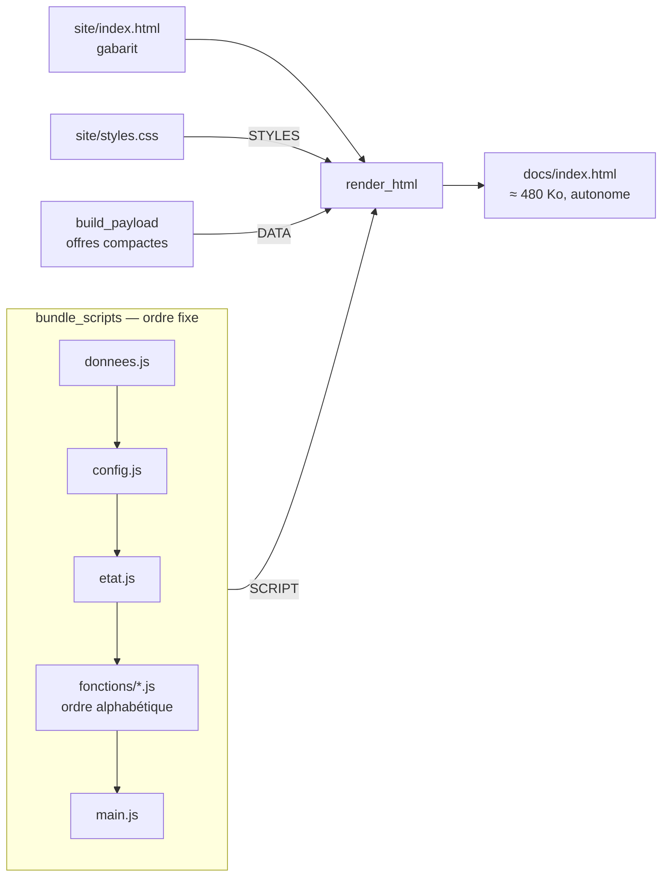

**Pourquoi une seule page ?**
- **Ouverture directe** : elle fonctionne même ouverte comme un fichier (`file://`), sans serveur ; on vérifie le rendu en local sans rien installer.
- **Un seul fichier à charger** : les 119 fichiers de fonctions sont assemblés en un seul script, donc pas de cascade de chargements.
- **Pas de framework ni d'outil de compilation** (React, Vite…) : rien à installer ni à mettre à jour côté JavaScript.

**Pourquoi l'ordre d'assemblage ne gêne pas ?** Toutes les fonctions sont déclarées avec `function nom()`. En JavaScript, ces déclarations sont « remontées » : elles existent dès le début du script, quel que soit l'endroit du fichier où elles apparaissent. Seuls `donnees.js`, `config.js` et `etat.js`, qui contiennent des constantes, doivent précéder `main.js`, qui démarre la page.

### 5.2 Format compact des données

Les 5 056 offres sont injectées dans la page sous forme de **colonnes**, et non d'une liste d'objets :

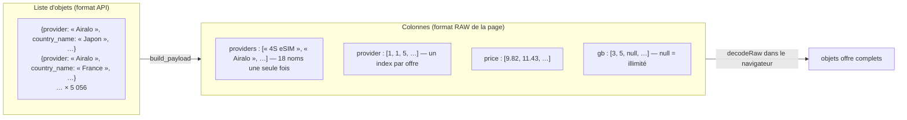

**Pourquoi ?** Le nom de chaque fournisseur, pays et clé de champ n'est écrit qu'une fois au lieu de 5 056. La page pèse environ 480 Ko ; le même contenu sous forme de liste d'objets (`docs/api/offers.json`) dépasse 1 Mo.

---

## 6. Le dashboard dans le navigateur `site/js/`

### 6.1 Démarrage de la page

[main.js](site/js/main.js) enchaîne :

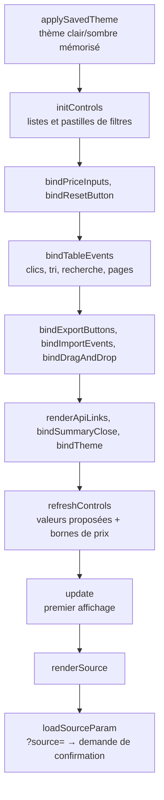

### 6.2 L'état de la page

Tout l'état vit dans [etat.js](site/js/etat.js). Les fonctions le lisent et le modifient, puis appellent `update()` :

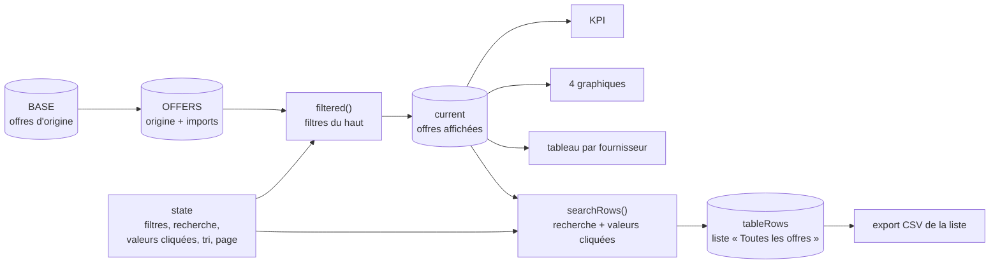

**Pourquoi un état global plutôt qu'un framework ?** Pour une seule page, un objet `state` suffit, et un unique `update()` redessine tout. Le flux reste simple à suivre : un événement modifie `state`, puis `update()` est appelé, puis les rendus sont refaits.

### 6.3 Le cycle `update()`

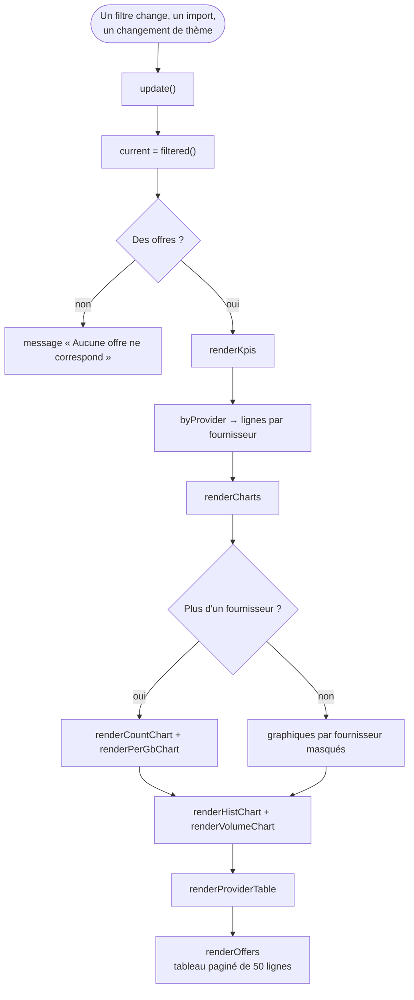

La recherche, le tri et les pages ne rappellent pas `update()` mais seulement `renderOffers()`. Les KPI et les graphiques ne bougent pas, et la saisie reste fluide.

### 6.4 La recherche multicritère

[parseQuery](site/js/fonctions/parseQuery.js) découpe le texte tapé en critères. [parseTerm](site/js/fonctions/parseTerm.js) interprète ensuite chaque mot :

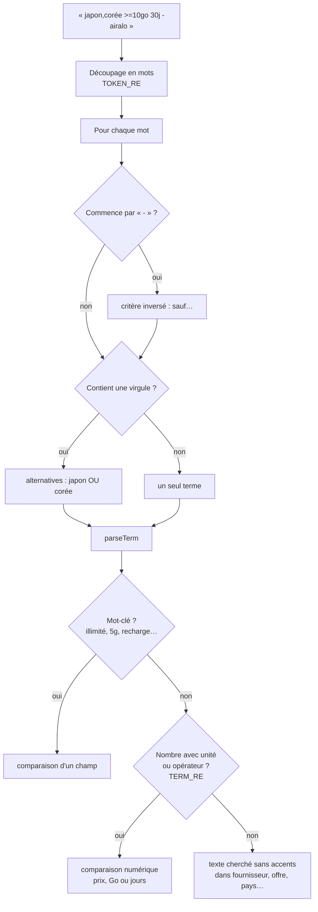

| Écrit | Compris comme |
|---|---|
| `<20€` | prix < 20 € |
| `20€` | prix ≤ 20 € (un budget) |
| `10-30€` | prix entre 10 et 30 € |
| `>=5go` / `500mo` | data ≥ 5 Go / data = 0,5 Go |
| `30j` | validité = 30 jours |
| `japon,corée` | japon **ou** corée |
| `-holafly` | **sauf** holafly |
| `"afrique du sud"` | texte exact |

Tous les critères doivent être respectés (ET). Les valeurs cliquées dans un tableau s'ajoutent comme critères : deux valeurs d'une même colonne se combinent en « ou », des colonnes différentes en « et ».

**Pourquoi un texte de recherche plutôt que des menus ?** Une seule ligne exprime une demande complète (« japon 5g <20€ 30j »), et on ajuste au clavier sans rouvrir de menus. Chaque critère compris s'affiche en pastille : on voit tout de suite comment la recherche a été interprétée.

### 6.5 Clic sur un graphique : résumé et filtre

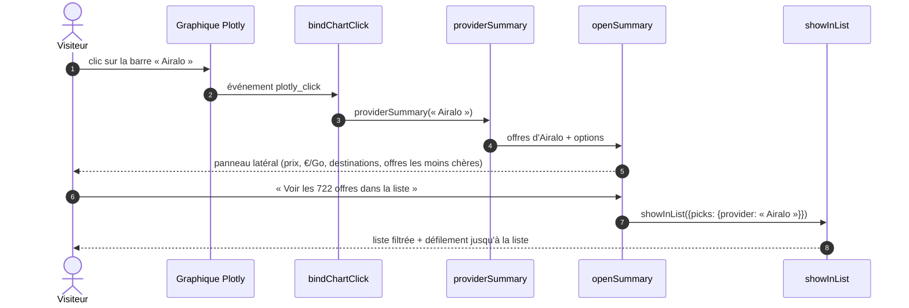

Les quatre graphiques suivent le même schéma : un graphique par fournisseur ouvre `providerSummary`, l'histogramme `priceBandSummary`, le graphique des volumes `volumeSummary`.

### 6.6 Import dans le navigateur

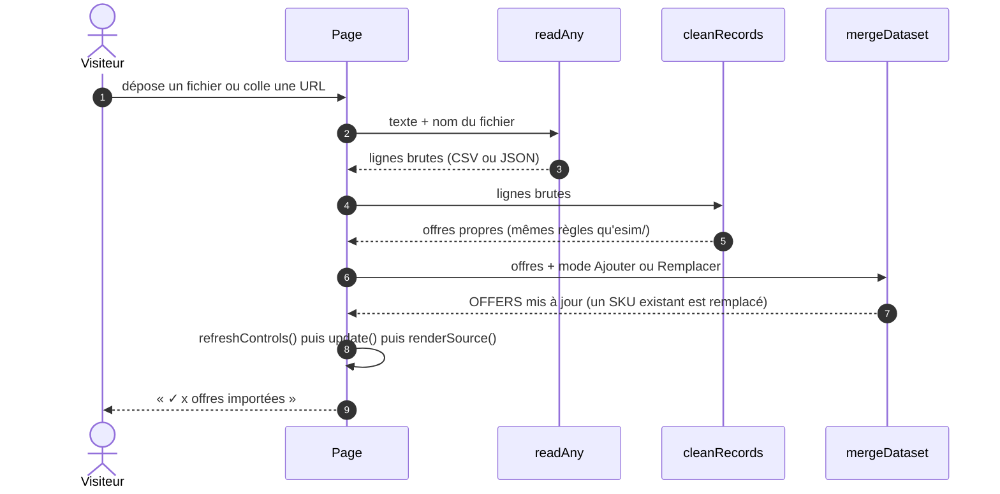

**Pourquoi refaire le nettoyage en JavaScript ?** Sur GitHub Pages, il n'y a pas de Python. [cleanRecords](site/js/fonctions/cleanRecords.js), [parsePrice](site/js/fonctions/parsePrice.js) et [parseData](site/js/fonctions/parseData.js) reprennent donc les règles d'`esim/`. Les fichiers importés **restent dans le navigateur** : rien n'est envoyé à un serveur. Des tests ont vérifié que les deux versions donnent les mêmes résultats, y compris pour un export suivi d'un réimport.

### 6.7 Couleurs des graphiques

| Graphique | Codage couleur | Raison |
|---|---|---|
| Offres par fournisseur | rampe bleue, plus foncée quand il y a plus d'offres | une quantité se lit sur une seule teinte |
| Prix moyen au Go | bleu sous la moyenne, rouge au-dessus, plus intense quand l'écart grandit | un écart se lit sur deux pôles opposés et un centre neutre |
| Distribution des prix | orange au-delà de 100 € | met en évidence le KPI « offres > 100 € » |
| Prix selon le volume | rampe bleue, illimité en violet | l'illimité n'est pas un volume : il a sa propre couleur |

La palette est validée pour les daltoniens et pour le contraste, en mode clair comme en mode sombre. Toutes les couleurs sont des variables CSS dans [styles.css](site/styles.css) : en changer une se fait à un seul endroit.

---

## 7. L'API REST `esim_api/`

### 7.1 Routes

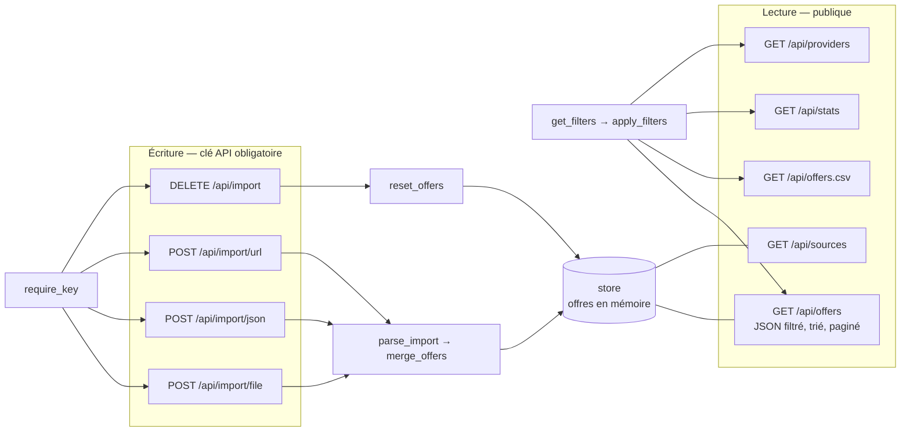

[esim_api/app.py](esim_api/app.py) ne contient aucune fonction : il crée l'application et déclare chaque route avec `add_api_route`, et chaque route vit dans son propre fichier.

### 7.2 Une requête d'import

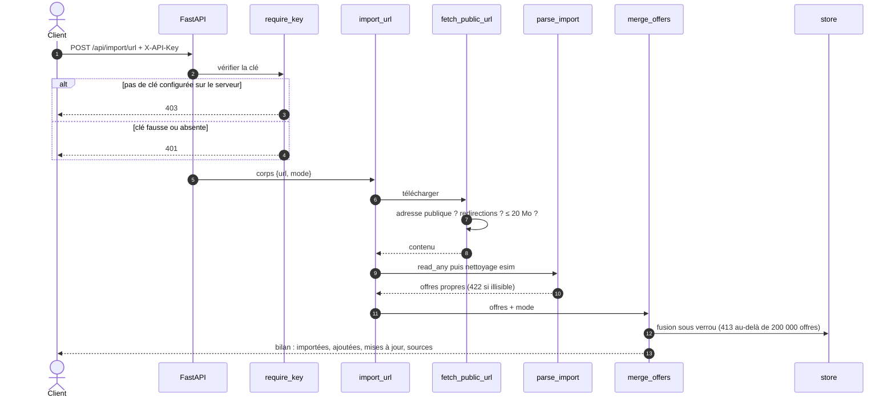

### 7.3 Données en mémoire

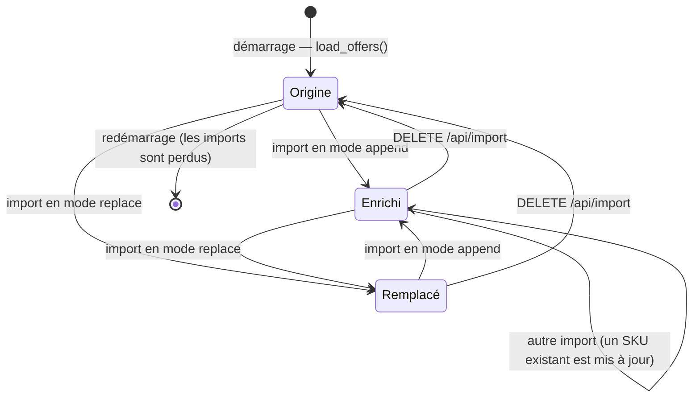

**Pourquoi tout garder en mémoire, sans base de données ?** Les données tiennent en mémoire (quelques Mo). Une base aurait ajouté un service à installer et à héberger, alors que l'offre gratuite de Render efface de toute façon le disque à chaque redémarrage. Un verrou ([store.lock](esim_api/store.py)) empêche deux imports simultanés de se mélanger.

---

## 8. L'application Streamlit `streamlit_ui/`

[app.py](app.py) se contente d'enchaîner les étapes ; chaque étape est une fonction de `streamlit_ui/` :

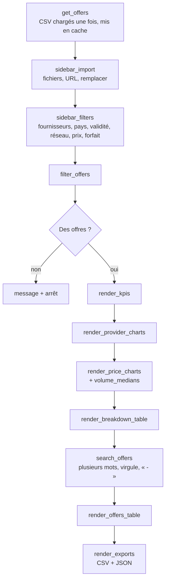

Streamlit réexécute tout le script à chaque interaction. C'est pourquoi les lectures coûteuses ([get_offers](streamlit_ui/get_offers.py), [import_sources](streamlit_ui/import_sources.py), [fetch_url](streamlit_ui/fetch_url.py)) sont mises en cache avec `st.cache_data`.

---

## 9. Sécurité

### 9.1 Les menaces et leurs protections

```mermaid
flowchart LR
    subgraph MENACES["Menaces"]
        M1["Données importées piégées<br/>&lt;img onerror&gt;, javascript:"]
        M2["URL interne<br/>127.0.0.1, 169.254.169.254"]
        M3["Autre site qui écrit<br/>dans l'API"]
        M4["Formule Excel<br/>=HYPERLINK(…)"]
        M5["Fichier énorme"]
        M6["Plotly modifié<br/>sur le CDN"]
        M7["Lien ?source= piégé"]
    end
    subgraph PROTECTIONS["Protections"]
        P1["esc() partout + filtrage Plotly"]
        P2["assert_public_url<br/>+ fetch_public_url"]
        P3["require_key<br/>clé obligatoire, compare_digest"]
        P4["csv_safe / csvCell<br/>apostrophe devant = + - @"]
        P5["lecture limitée à 20 Mo,<br/>20 fichiers, 200 000 offres"]
        P6["attribut integrity (SRI)"]
        P7["confirmExternalSource"]
    end
    M1 --> P1
    M2 --> P2
    M3 --> P3
    M4 --> P4
    M5 --> P5
    M6 --> P6
    M7 --> P7
```

### 9.2 Téléchargement d'une URL (anti-SSRF)

Sans contrôle, une API hébergée pourrait être utilisée pour lire ses propres services internes, par exemple l'adresse des métadonnées cloud `169.254.169.254`. C'est ce qu'on appelle une attaque SSRF. [fetch_public_url](esim/fetch_public_url.py) l'empêche :

```mermaid
flowchart TD
    U["URL demandée"] --> A["assert_public_url"]
    A --> S{"http ou https ?"}
    S -- "non" --> X1["refus"]
    S -- "oui" --> R["résolution DNS<br/>toutes les adresses IP"]
    R --> P{"Toutes publiques ?<br/>pas de 127.x, 10.x,<br/>192.168.x, 169.254.x, ::1"}
    P -- "non" --> X2["refus : adresse non publique"]
    P -- "oui" --> G["GET sans suivre les redirections"]
    G --> RD{"Redirection ?"}
    RD -- "oui, 3 au plus" --> A
    RD -- "plus de 3" --> X3["refus"]
    RD -- "non" --> L["lecture par morceaux"]
    L --> T{"Plus de 20 Mo ?"}
    T -- "oui" --> X4["refus"]
    T -- "non" --> OK["contenu renvoyé"]
```

Chaque redirection repasse par le contrôle : un site public ne peut donc pas rediriger vers `127.0.0.1`. Pour le développement local, `ESIM_ALLOW_PRIVATE_URLS=1` lève la restriction.

*Limite connue :* entre le contrôle et le téléchargement, le nom de domaine est résolu deux fois. Quelqu'un qui contrôle un domaine pourrait en changer l'adresse IP entre les deux (« DNS rebinding »). Le risque est faible pour ce projet.

### 9.3 Écriture dans l'API

```mermaid
flowchart TD
    Q["Requête POST ou DELETE"] --> K{"ESIM_API_KEY<br/>définie sur le serveur ?"}
    K -- "non" --> O{"ESIM_OPEN_WRITE=1 ?<br/>développement local"}
    O -- "oui" --> OK["acceptée"]
    O -- "non" --> R403["403 : écriture désactivée"]
    K -- "oui" --> H{"En-tête X-API-Key identique ?<br/>comparaison à temps constant"}
    H -- "oui" --> OK
    H -- "non" --> R401["401"]
```

**Pourquoi refuser par défaut ?** Le CORS est ouvert à tous les sites, pour que le dashboard GitHub Pages puisse lire l'API. Sans clé, n'importe quelle page web visitée pourrait donc aussi y écrire. Exiger une clé ferme cette porte, et `render.yaml` génère la clé automatiquement au déploiement.

### 9.4 Données personnelles

- Aucun secret n'est stocké dans le dépôt : la clé API vient de l'environnement du serveur.
- Les commits sont signés avec l'adresse noreply de GitHub, pas avec un e-mail personnel.
- Le [.gitignore](.gitignore) exclut les `.env`, les clés, `.streamlit/secrets.toml` et les exports téléchargés.

---

## 10. Normes du code et vérifications

### 10.1 Contrôle automatique

[verifier_normes](outils/verifier_normes.py) passe en revue tous les fichiers :

```mermaid
flowchart TD
    F["Chaque fichier .py, .js, .css, .html"] --> C["Compter les fonctions nommées<br/>ast pour Python, regex pour JS"]
    C --> T{"Fichier de fonction ?"}
    T -- "oui" --> R1{"Exactement 1 fonction ?"}
    R1 -- "non" --> E["erreur"]
    R1 -- "oui" --> R2{"≤ 80 lignes ?"}
    R2 -- "non" --> E
    R2 -- "oui" --> R3{"Lignes ≤ 100 caractères ?"}
    R3 -- "non" --> E
    R3 -- "oui" --> OK["conforme"]
    T -- "non" --> Z{"Contient une fonction ?"}
    Z -- "oui" --> E
    Z -- "non" --> W{"Lignes > 100 caractères ?"}
    W -- "oui" --> AV["avertissement"]
    W -- "non" --> OK
```

Les fonctions anonymes passées en argument (`rows.map(o => o.price)`, gestionnaires d'événements) font partie de la fonction qui les contient. Les comportements autrefois cachés dans des objets ont été remplacés par des données et des fonctions nommées : par exemple les opérateurs de comparaison ([compareValues](site/js/fonctions/compareValues.js)) et les contrôles de filtre ([createChips](site/js/fonctions/createChips.js), [pickChip](site/js/fonctions/pickChip.js)…).

### 10.2 Comment les changements ont été vérifiés

Chaque réorganisation importante a été contrôlée en comparant le comportement **avant** et **après** :

```mermaid
flowchart LR
    A["Instantané avant<br/>(ancien code)"] --> CMP{"Comparaison"}
    B["Instantané après<br/>(nouveau code)"] --> CMP
    CMP --> P["Python : offres nettoyées, réponses de l'API,<br/>fichiers docs/api, données de la page"]
    CMP --> J["Navigateur (Chrome headless) : 32 parcours<br/>filtres, recherche, clics, résumés, import, export, thème"]
    CMP --> S["Streamlit : 6 scénarios<br/>filtres, recherche, aucun résultat, erreur d'URL"]
```

Les correctifs de sécurité ont en plus été testés par 25 tentatives d'attaque : adresses internes, redirection piégée, mauvaise clé, fichier trop gros, formules et noms piégés.

---

## 11. Choix techniques en résumé

| Choix | Alternative écartée | Raison |
|---|---|---|
| Nettoyage Python avec pandas | nettoyage à la main | lecture CSV robuste, calculs par colonne, groupements par fournisseur en une ligne |
| Un moteur `esim/` partagé | du code de nettoyage dans chaque interface | une seule source de vérité : les trois interfaces donnent les mêmes chiffres |
| Page statique autonome | application avec serveur | hébergement gratuit sur GitHub Pages, aucune maintenance de serveur |
| JavaScript sans framework | React, Vue, Vite… | aucune dépendance ni compilation ; une seule page n'en a pas besoin |
| Données en colonnes dans la page | liste d'objets | page plus légère (≈ 480 Ko au lieu de plus de 1 Mo) |
| Plotly (CDN avec SRI) | graphiques dessinés à la main | interactivité (infobulles, clics) prête à l'emploi ; le contrôle d'intégrité protège du CDN |
| Recherche en texte libre | uniquement des menus | une ligne exprime une demande complète, et les pastilles montrent l'interprétation |
| Nettoyage refait en JavaScript | import envoyé à un serveur | les fichiers importés restent dans le navigateur |
| API FastAPI en mémoire | base de données | simple, rapide ; l'hébergement gratuit efface le disque de toute façon |
| Clé API obligatoire | écriture ouverte | le CORS ouvert permettrait sinon à n'importe quel site d'écrire |
| Une fonction par fichier | gros modules | lisibilité et navigation (norme du projet) |
| Assemblage au build | modules ES chargés par le navigateur | une seule requête et fonctionnement en `file://` |
